<!-- SponsorLive by Advith Ashok (github.com/Advith023/sponsor-live-jobs). Copyright (c) 2026 Advith Ashok. All rights reserved. Not licensed for reuse; see LICENSE. -->
# How SponsorLive works

**SponsorLive** lists live UK jobs at companies that hold a Home Office licence to sponsor work visas. Every job comes straight from the company's own careers system, checked twice a day.

This guide explains how it works in three layers. Read as far as you need:

1. [The 2-minute version](#1-the-2-minute-version) (no technical knowledge needed)
2. [How the pieces fit together](#2-how-the-pieces-fit-together) (diagrams and a walkthrough)
3. [The technical deep dive](#3-the-technical-deep-dive) (design decisions, data model and code)

Plus: [what makes it different](#4-what-makes-it-different), [results so far](#5-results-so-far), [lessons learnt](#6-lessons-learnt) and a [glossary](#7-glossary).

*Figures are from 13 November 2026: **5,520 live UK jobs at 519 licensed sponsors**, with 16,449 of the 120,259 sponsors on the register checked so far. Coverage grows every day.*

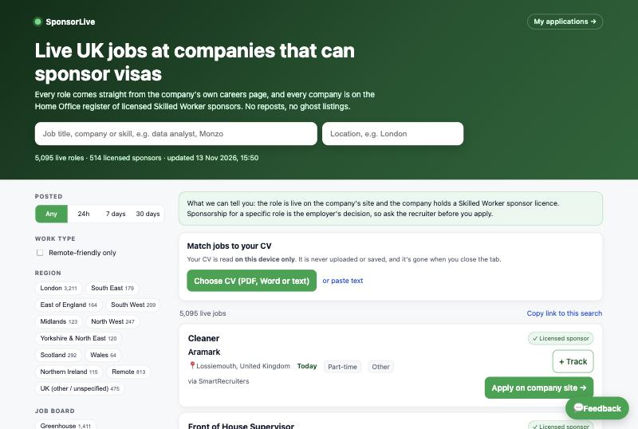

---

## 1. The 2-minute version

Imagine you need a job in the UK, and your visa means only certain companies are allowed to hire you. The government keeps a list of those companies, but the list is **120,000 names long** and says nothing about which of them are hiring right now. Job sites are full of adverts that closed weeks ago, or that come from companies that can't sponsor you at all.

SponsorLive is like a **robot helper that does the boring checking for you**:

1. **Every morning and afternoon, it reads the government's list** of companies allowed to sponsor visas.
2. **For each company, it goes looking for the company's own jobs page.** Companies use different "job systems" (think of them as different shops with different shelves), so the robot knows how to read 13 kinds of shelf.
3. **It writes down only the jobs that are live right now and in the UK**, with a link straight to the company.
4. **It adds helpful labels to each job**: which part of the UK, what kind of work, which skills it asks for and how many years of experience.
5. **It puts everything on a website** where you can search, filter, check your CV against every job and keep track of what you've applied for.

Nobody has to press a button. The robot runs by itself, for free, and the website updates on its own.

---

## 2. How the pieces fit together

### The big picture

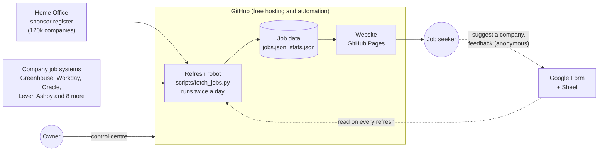

There are only four moving parts:

| Part | What it is | Where it lives |
|---|---|---|
| **Refresh robot** | A Python program that finds companies' job boards and reads their jobs | `scripts/fetch_jobs.py`, run by GitHub Actions |
| **Job data** | Two small files the robot writes: the jobs and some statistics | `site/data/` |
| **Website** | Plain HTML, CSS and JavaScript. No server, no database | `site/`, hosted on GitHub Pages |
| **Control centre** | A private page for the owner to run refreshes, review suggestions and edit the site | `site/admin/` |

### What happens on every refresh

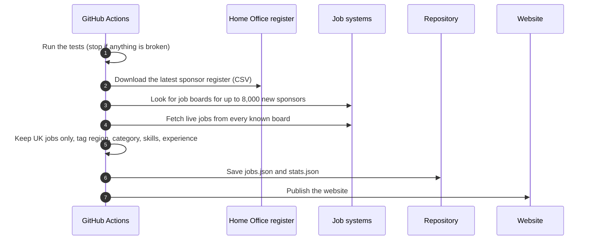

It runs at **05:17 and 13:43 UTC** every day (UK time in winter). Each run takes up to about two hours and costs nothing.

### Mapping: how each job system is read

Every company uses a hiring system (called an ATS, applicant tracking system). Each one publishes its jobs differently, so the robot has a small "reader" for each.

| Job system | How the robot finds it | How it reads jobs | Typical users |
|---|---|---|---|
| Greenhouse | Guesses a board name from the company name and checks it | Public JSON job board | Tech and fintech |
| Lever (UK and EU) | Same | Public postings API | Scale-ups |
| Ashby | Same | Public job board API | Start-ups |
| Workable | Same | Public widget API | Small and mid-size firms |
| SmartRecruiters | Same | Public postings API, filtered to the UK | Large employers |
| Recruitee | Same | Public offers API | European firms |
| Personio | Same | Public XML feed | European firms |
| Breezy | Same | Public JSON feed | Small firms |
| Teamtailor | Same | Public RSS feed | Nordic and UK firms |
| Pinpoint | Same | Public postings JSON | UK firms |
| BambooHR | Same | Public careers list | Small firms |
| **Workday** | Reads Workday's public `robots.txt`, which lists each company's career site, then checks the hiring company's name matches | Public job search API with the UK location filter | Banks, large corporates |
| **Oracle Recruiting** | From a link, or found by the careers-page sniffer | Public candidate API with the UK location filter | Banks, retailers |
| Any careers page | From a link | Reads schema.org `JobPosting` data that sites publish for Google Jobs | Everyone else |

### How a company gets found

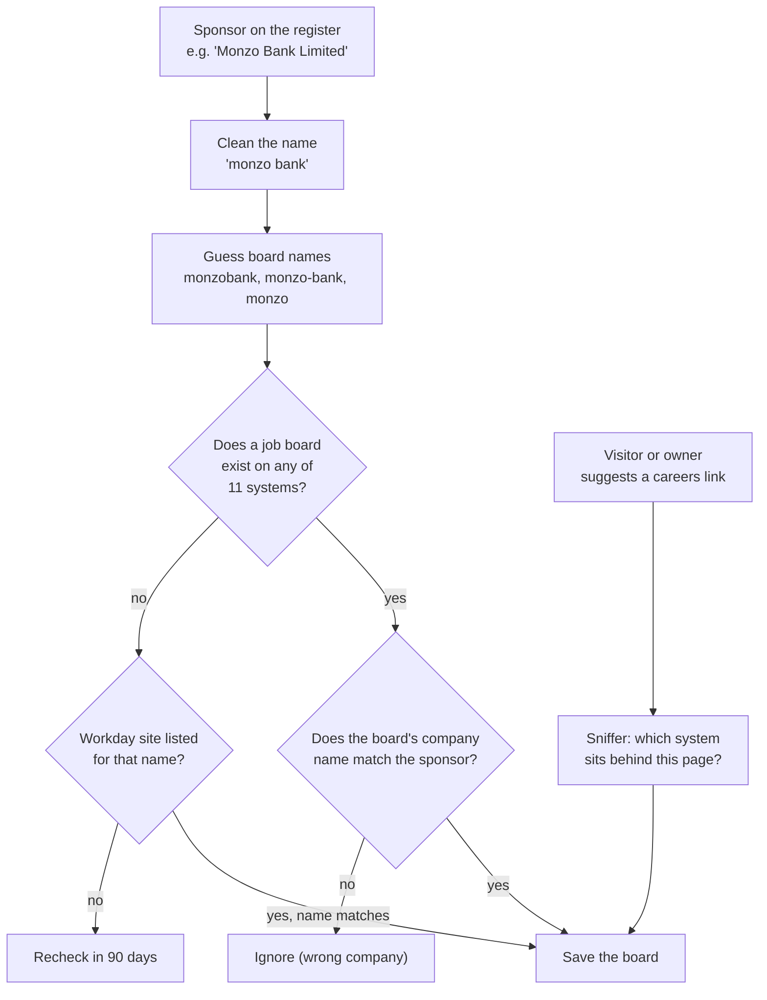

### The website

The website is a single page that loads the job data and does everything else **in the visitor's browser**.

- **Search and filters**: keyword, location, how recent, remote only, UK region, job system and category. Every search can be shared as a link.
- **CV matcher**: the visitor uploads a CV (PDF, Word or text). It is read on their own device and never uploaded. The site finds the skills and years of experience on it and scores every job.
- **Application tracker**: "+ Track" on any job saves it to a personal tracker, again stored only on that device. On a computer, the CV and cover letter used for each application can be saved into a folder of the visitor's choice.
- **Suggestions and feedback**: anonymous, through a Google Form. No names, no emails, no login.

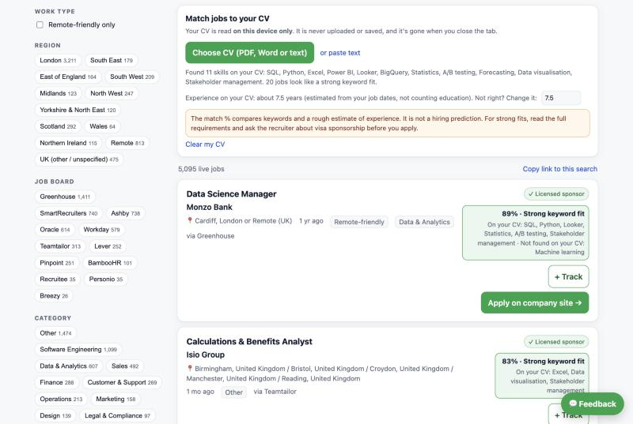

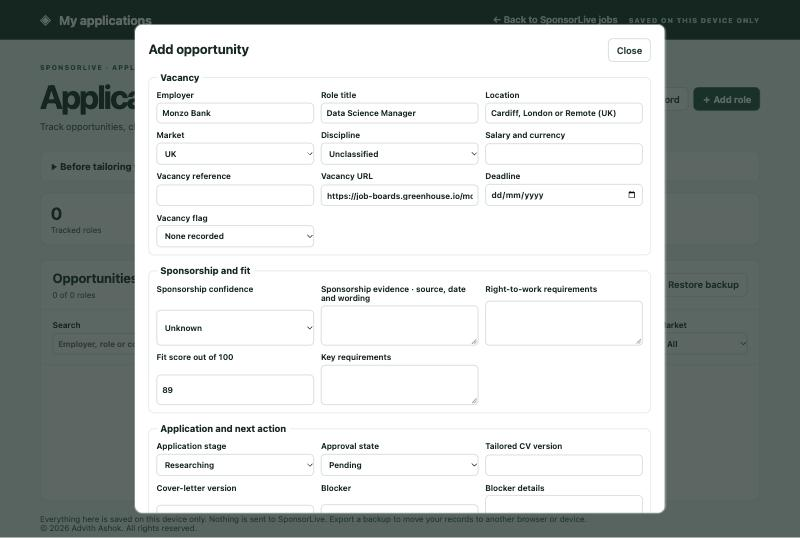

### The control centre

A private page where the owner signs in with their own GitHub key. It talks straight to GitHub, so there is still no server.

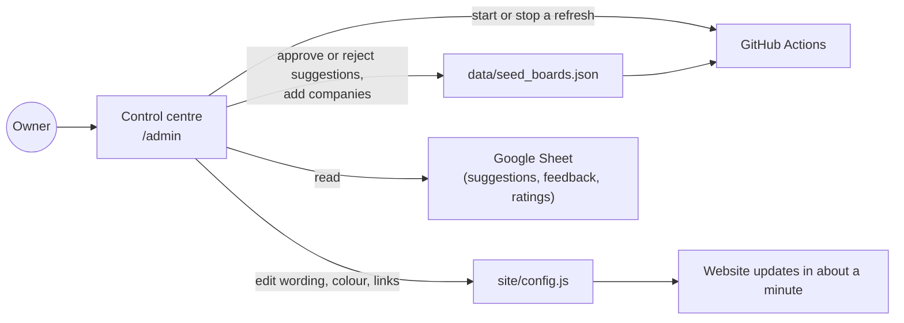

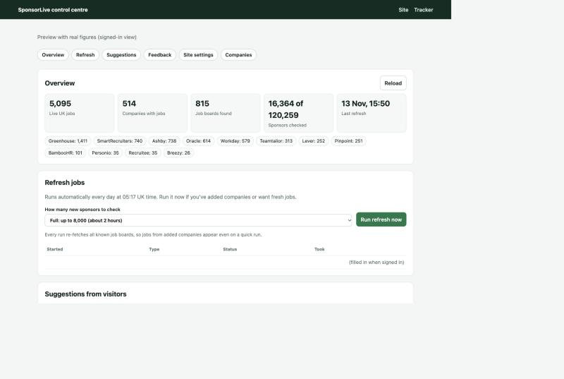

---

## 3. The technical deep dive

### Design principles

1. **No server, no database, no cost.** Everything runs on GitHub Actions and GitHub Pages. The data is two JSON files. That keeps it free, fast and hard to break.
2. **Only verifiable claims.** A job is shown only if it is live on the employer's own system today and the employer is on the register. The site says "holds a sponsor licence", never "will sponsor you".
3. **Privacy by design.** CVs and application records never leave the visitor's device. Suggestions and feedback are anonymous, so no personal data is collected.
4. **Fail safe.** Every network call can fail without breaking the run. A board that returns nothing three times in a row is dropped. Tests run before every refresh.
5. **Be a good citizen.** Public endpoints only, a clear user agent, `robots.txt` respected on ordinary websites, and polite request rates.

### The data model

`site/data/jobs.json` holds one compact record per job. Short keys keep the file small enough to load quickly on a phone.

| Key | Meaning | Example |
|---|---|---|
| `t` | Job title | "Senior Data Analyst" |
| `c` | Company name, tidied from the register | "Monzo Bank" |
| `sp` | Sponsor name on the register | "Monzo Bank Limited" |
| `l` | Location text | "London / United Kingdom" |
| `u` | Apply link (company's own site) | `https://...` |
| `p` | Date posted | "2026-11-12T09:00:00+00:00" |
| `r` | Remote-friendly | `true` |
| `src` | Job system | "Greenhouse" |
| `cat` | Category | "Data & Analytics" |
| `rg` | UK regions | `["London", "Remote"]` |
| `k` | Skills found in the description (indices into `skills.json`) | `[0, 1, 5]` |
| `y` | Minimum years of experience asked | `3` |
| `lv` | Seniority from the title | "Senior" |

`stats.json` holds the totals, jobs per system, and the result for every company the owner or visitors added (matched to the register or not, how many jobs it produced, and the closest register names if it didn't match).

### Matching companies to the register

The hardest problem is names. The register says "SAINSBURYS SUPERMARKETS LIMITED" or "J Sainsbury Plc"; a job board says "Sainsbury's". The pipeline:

1. **Normalises** names: lower case, removes legal suffixes (Ltd, PLC, LLP), punctuation and words like "UK" and "Group".
2. **Tries exact, prefix and trading-name ("T/A") matches**, then a version with spaces and apostrophes removed.
3. **Checks the other way too**: a board's own company name must overlap with the sponsor's name, so "Monzo" on Greenhouse can't be attached to an unrelated "Monzo Builders".
4. **For Workday guesses based on the first word only**, every other distinctive word of the sponsor's name must appear in the employer name. This rule was added after a real mistake: "Baxter Games Newcastle" had been matched to the Workday site of Baxter, the healthcare company. A one-off re-check then removed 24 of 61 Workday matches that failed the stricter test.
5. **When a suggestion doesn't match**, the closest register names are listed in the control centre so the owner can fix it by hand. That is how "Sainsbury's" was traced to "J Sainsbury Plc", which added 352 jobs.

### Discovery at scale

- 120,259 sponsors cannot all be checked in one run, so each run probes up to **8,000 new sponsors**, likeliest first (tech, finance and London-area names), within a **100-minute budget**.
- Results are cached in `data/ats_cache.json`. Sponsors with a board are re-fetched on every run. Sponsors without one are re-checked after 90 days.
- Requests run in parallel (32 workers) with retries and timeouts.

### Two tricks worth knowing

**Workday's robots.txt.** Workday career sites have unguessable names such as `External_Career_Site_Barclays`. But every Workday tenant publishes a `robots.txt` that lists its career sites, and unknown tenants return an error. So the robot can test a company-name guess on the 9 common Workday hosts cheaply, then confirm the hiring company's name from one job before accepting it.

**The careers-page sniffer.** Many big companies wrap their real hiring system in their own branded website. The sniffer reads the careers page, and if needed a few of its job pages, looking for the fingerprints of known systems in links and code. Sainsbury's own careers site, for example, sends applicants to an Oracle Recruiting system; once that was spotted, all 352 of its UK jobs could be read through Oracle's public API.

### Tagging every job

| Tag | How it is worked out |
|---|---|
| **UK only** | Location text checked against UK place names and country codes, with "false friends" excluded (Birmingham, Alabama; Perth, Australia) |
| **Region** | 10 regions from a list of cities and counties, plus Remote |
| **Category** | Rules on the job title and department |
| **Skills** | A vocabulary of 164 skills with aliases (for example "PySpark" counts as Spark), matched as whole words in the description. Short or ambiguous terms such as "R" and "Go" are only matched when written as the skill, so "go-getter" doesn't count as the Go language |
| **Experience** | Phrases such as "3+ years of experience", "minimum of five years" and "experience: 3 to 5 years" in the description, ignoring company history ("founded 10 years ago") |
| **Seniority** | Words in the title: Graduate, Junior, Senior, Lead, Head of |

### The CV matcher

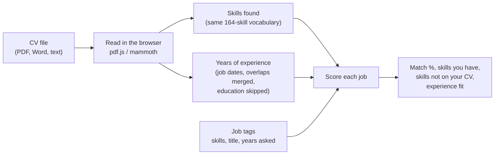

- **Score** = 75% share of the job's listed skills found on the CV + 25% of the job title's words found on the CV.
- **Generic words** that appear in company boilerplate (communication, leadership) count when the CV has them, but never against the person.
- **Experience** only lowers the score when the CV clearly falls short of what the job asks.
- **Jobs with little detail** are capped below "strong fit", because a title alone isn't enough evidence.
- Every result carries a reminder that this is a keyword match, not a hiring prediction.

### Testing and quality

- 13 automated tests cover link recognition, region tagging, skills and experience parsing, company matching, Workday and Oracle parsing and the sniffer. Responses are recorded from the real systems so the tests run offline.
- The tests run before every refresh. If they fail, the site keeps showing the last good data.
- Each new job system was checked against live employers before going in (for example JPMorgan for Oracle, Barclays for Workday).

### Limits, stated plainly

- Coverage is a sample, not every UK job: 16,449 of 120,259 sponsors have been checked so far, and some companies hire through agencies or don't advertise online.
- Some careers sites can't be read automatically. One large employer only publishes its jobs through a private search service, so it is not included.
- Skills and experience are found by keyword rules. They can miss unusual wording.
- A sponsor licence means the company *can* sponsor. Whether it will for a particular role is the employer's decision.

---

## 4. What makes it different

| | Typical job boards | SponsorLive |
|---|---|---|
| Source | Reposts and scraped adverts | The employer's own hiring system, every time |
| Freshness | Often stale | Checked twice a day; closed jobs disappear |
| Sponsorship | Self-declared or unchecked | Every company is on the Home Office register |
| CV matching | Usually uploads your CV to a server | Runs on your device; nothing is uploaded |
| Tracking | Separate tools | Built in, with the exact CV and cover letter per application |
| Running cost | Servers and databases | Zero: GitHub Actions and Pages |

---

## 5. Results so far

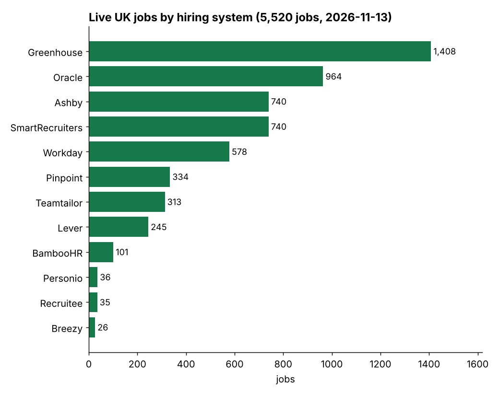

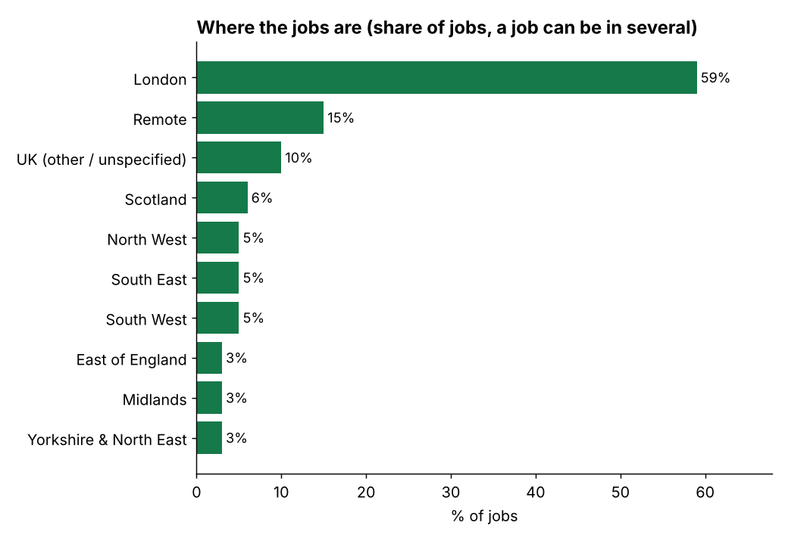

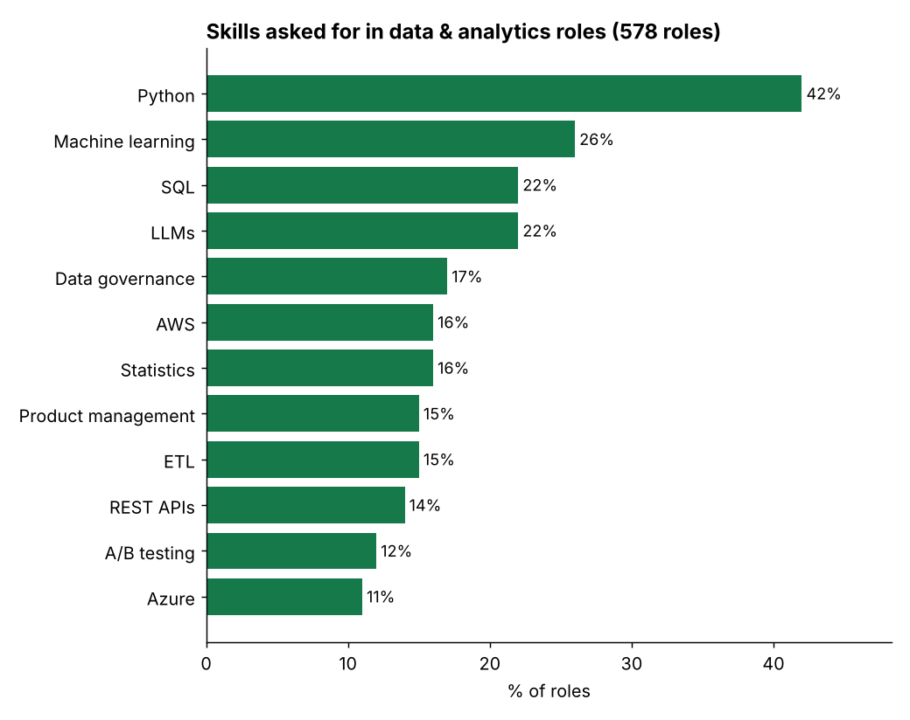

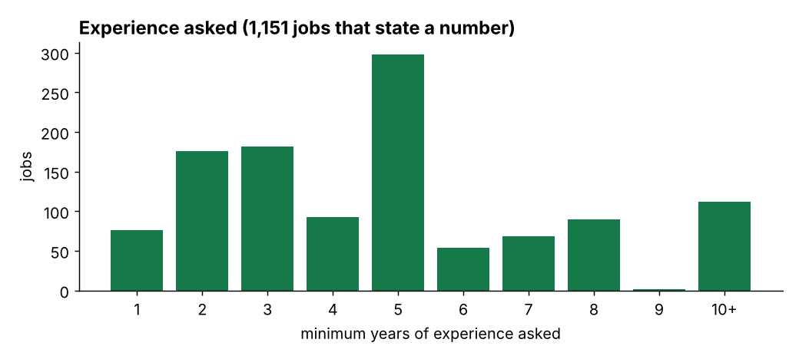

A few findings from the data:

- **Only about 2% of sponsor jobs show a salary.**
- **London dominates**, with remote working the second largest "region".
- **In data and analytics roles**, Python, SQL and machine learning lead, and large language models already appear in about one in five adverts.
- **Where a number is given, the median experience asked is 5 years.**
- **Only a small share of licensed sponsors have live jobs** on systems that can be read at any moment, which is exactly why a live check matters.

---

## 6. Lessons learnt

1. **Start with the data you can trust.** The register and the employers' own systems are the two sources of truth. Everything else is derived and labelled as such.
2. **Names are the hardest part of joining datasets.** Most of the effort went into matching company names safely, and the biggest bug was a name match that was too loose.
3. **Check the shape of real responses before writing a reader.** Every system was tested against a live employer first. Assumptions about formats were wrong more than once.
4. **Find the cheap signal.** Workday's `robots.txt` and the careers-page sniffer turned hard discovery problems into a few cheap requests.
5. **Privacy can be a feature, not a cost.** Doing the CV matching in the browser avoided collecting personal data at all.
6. **Static sites go a long way.** Two JSON files, a scheduled job and a static site do the work that many products build servers for.
7. **Say what you don't know.** Coverage, limits and the meaning of "licensed sponsor" are stated on the site and here.

---

## 7. Glossary

| Term | Meaning |
|---|---|
| **Sponsor licence** | Permission from the Home Office for a company to hire people on certain work visas, such as the Skilled Worker visa |
| **Sponsor register** | The public list of licensed companies, published by the Home Office |
| **ATS** | Applicant tracking system: the software a company uses to post jobs and receive applications |
| **API** | A way for one program to ask another for data, here used to read job lists |
| **JSON** | A simple text format for data, readable by people and programs |
| **GitHub Actions** | GitHub's free service for running programs on a schedule |
| **GitHub Pages** | GitHub's free hosting for static websites |
| **robots.txt** | A file websites publish to tell automated visitors what they may read |
| **schema.org JobPosting** | A standard way for websites to describe a job so search engines can show it |
| **Fingerprint** | Identifying details deliberately left in data or code to show where it came from |

---

*SponsorLive is designed and built by Advith Ashok. Copyright (c) 2026 Advith Ashok. All rights reserved. The code is public to read, not to reuse; see [LICENSE](../LICENSE).*
